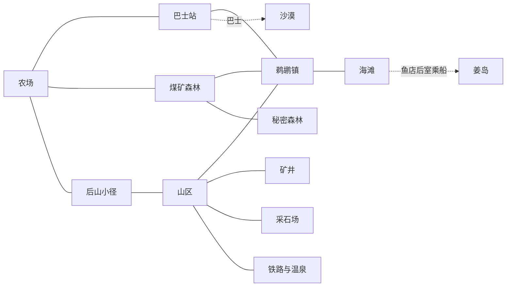

# 《采邑春秋》地形系统设计

## 系统概述

《采邑春秋》的地形系统包括：
1. **世界地图**：探索区域
2. **封地地图**：玩家经营的封地
3. **地形类型**：平原、山地、森林、水域等
4. **地块系统**：TileMap网格化
5. **季节变化**：视觉效果和游戏影响

---

## 1. 世界地图

当前可走的路线从封地东关通往竹涧，返程从东关内继续。野果坳在西岸北侧，木桥和浅滩把两岸的道路接成一圈，东岸望溪台可以采药。每日可在野果补粮、野药疗伤和垂钓中收获一次。深溪阻挡通行，路标和水岸画面对应实际可走的位置。

东关和西门的两座关柱立在路肩，切图触发区在柱间的道路上。走入路口后暂缓移动和时辰，画面完全遮住时切换到目标场景和落点。角色沿落点朝向站稳，沿用当前视野缩放。画面亮起后，持续按住方向键即可沿路继续。作物、浇水、体力和选种随往返保留。每处路口配置目标场景、到达标记和目标角色，标记的朝向决定到达时的朝向。

在西市和竹涧活动时，封地门客会随时辰推进浇水、补播与收割。切图、交谈和暂停期间田务与时辰一同暂缓。回封地可在「今夜安排」查看当天外出期间的田务。

封地舆图按同一比例绘出实际道路、井田、沟渠和当前位置。按 M 或点击顶部「舆图」打开。地点页标出东关、水源和已经建成的设施。井田页列出施工阶段、剩余夜数或渠水覆盖，图上逐格标出可收、待浇和断水作物。人物页标出此刻在场的来客与门客。选择图上标记或索引条目后，回封地沿金色指引走。每次打开都读取当前封地，过夜后的施工和来访变化会显示在图上。

点种子栏的「田务」直接打开井田页。选一类田务后回到封地，先标出最近的公田，再标私田。完成当前格后会按当时的位置和田况标出下一格，切回封地或续档时按当前田况恢复。断水稻田的指引在挖渠时继续显示。完成同类田务、取消、换目的地或过夜会结束指路。

第一块井田坐落在堂前东南的草地上。南侧一格宽的土径直达等宽的田埂缺口，横路在下田口以南通往东岗。南行主路绕到水源以西，水源与田之间留出接渠的草地。封地路肩沿弧形路面过渡到草地，舆图和脚步表面读取同一套路形。田地、水渠和作物沿同一田格坐标放置，旧档保留公私田、作物和渠线的相对位置。

封地主路穿过关柱后延伸到镜头边界外。井田完工后，若附近有路可直接接入，田埂便朝路开出一格宽的田口。短径避开邻田和建筑用地，封地舆图也绘出田口和短径。驾御的马车停在东路田口以东，路牌在车后。草丛沿路肩与林边分布，田埂高于路面。北坡石垒的底部对应北侧行走边界，坡上分近林与远林。雨天路面压暗，冬日石垒顶部和松枝积雪。水渠和木板从地表上方绘制。

从石前坪向北走过堂屋门槛，可进入室内。堂屋随封地载入，出入共用路口的淡出淡入，屋内的固定镜头可同时看到书案、床榻和南门。室内与封地共享时辰和田务结算。走出南门会回到堂前，舆图在室内将当前位置标在堂前。

靠近书案按 E 研读简册，与管理面板共用每天一次的研读机会。靠近床榻按 E 查看田务和口粮，点「过夜」推进一天。屋内存档和晨间档从床榻旁继续。

靠近窗下的木案按 E 打开「堂屋陈设」。地席和窗下摆件各有一个位置。选择后直接在房间里预览，点「应用陈设」后摆放，按 Esc 或手柄 B 取消。陈设期间暂停时辰，应用后可用手动存档或过夜保存。旧档第一次打开堂屋时使用素苇席和空案。

蚕棚建成后可从堂前南面的支路进门。屋里从左到右是蚕匾、缫丝车和织机，南门接回支路。棚内存档从门内继续，舆图将当前位置标在蚕棚。

封地西路通往西市。从西边两柱之间走出封地，沿石板街可到粮摊、鱼摊和绸摊。靠近摊前按 E 交易，向东过关柱回封地。西市卸货场的收货牌可查时令单。交齐后，车夫申禾在酉时带货沿西路和南行道到封地南路卸货场，酉时起交的货在次日辰时发车。晚交跨季时，上一季货物仍按时发出。到货后可在车旁和申禾交谈。西市与封地共用时辰和物资，市集存档从靠封地的路口继续。货车在路上的位置随时辰恢复。

石板从摊前铺到东侧关柱，摊沿留出泥地供进出。走上石板时会听到石面脚步。谷伯、渔生和蔡娘在柜台后理货，客人走到摊前时会抬头。背筐伙计早上到粮摊边，巳时走到鱼摊南侧，傍晚沿石板街向东出关。继续游戏时，伙计按存档时辰回到路上。入夜后可以在灯下交易。

西市舆图沿用实际石板路和摊前站位，按玩家坐标标出当前位置。点选粮摊、鱼摊、绸摊、收货牌或回封地，街上会显示方向箭头和金色地标。封地的买粮、交鱼和备齐的时令单先指向西关，过关后继续指向相应摊位或收货牌。存档保留所选去处，打开对应摊位或从返程关口回封地时完成指引。 [《星露谷物语》1.6 的地图位置更新](https://www.stardewvalley.net/stardew-valley-1-6-update-full-changelog/)

从井田下行先到南路亭。亭前晚坐的席案在亭东小径尽头。沿竹径再往南到岔口，向西可到卸货场和交货簿，向西南沿牧道可到羊棚，向东可到灶台。完成首单后可看到灶火和热气，申禾到卸货场后也能帮忙指路。舆图点选南路去处后，街上的金线沿相应的岔路走。

灶台以东的支路绕向东南空地。秋分摆秋社展台，冬至摆围炉桌。乡邻沿支路到场，玩家从南面靠近。历书和舆图指向台前站位。秋社铜簋参考了春秋时期龙耳簋的方座和双耳轮廓。 [克利夫兰艺术博物馆藏龙耳簋](https://www.clevelandart.org/art/1974.73)

封地舆图的「竹涧」页可在出发前查看野果粮食、野药能恢复的气血、两处钓点的鱼种与抛竿耗费。选好地名后先沿金色标记去东关，进竹涧后继续沿山路标记走。出发前保存的目的地随续档恢复。

竹涧舆图用实际地形坐标画出两岸道路、溪流、采集点和返程西门。按 M 或点击右上角按钮查看当前位置，选择一个地名后沿山路上的金色标记走。已接触溪行手记的玩家可选择今日水迹。路线会随走动更新，到达后消失，也可手动清除。

在竹涧可打开「设置」手动存档。续档从西门内开始，以保存的时辰、体力、气血和当日收获继续。山路指引从西门重新计算，水迹指引接到原来的立牌，交鱼指引接到西市选定的去处。

封地和竹涧随季节更换树形和地表细节。春有花树与散瓣，夏有密叶和长草，秋有红叶和落叶，冬有枯枝、覆雪的松树和溪岸薄霜。谷雨有雨线和雨声。踩上积雪会听到雪声并留下逐渐消失的脚印，桥面和浅滩各有对应的脚步声。树冠和人物按脚下位置排序，走到树后时树冠会淡出一部分。井田与沟渠显示在地表上方。

### 地点分布与步行间隔

《星露谷物语》主谷的户外连接有三条常走路线。农场经巴士站到镇上，经煤矿森林也能到镇上，经后山小径则先到山区。镇内商店和住宅成组排布，广场、河流和桥把这些组分开。ConcernedApe 在第 18 次开发日志里记录了扩大镇区给建筑留空间的过程。 [开发日志与早期实景](https://www.stardewvalley.net/dev-update-18/) · [鹈鹕镇全景](https://stardewvalleywiki.com/Template:Pelican_Town_Map) · [鹈鹕镇出入口](https://stardewvalleywiki.com/Pelican_Town)



| 主地图 | 地点如何分布 |
| --- | --- |
| 农场 | 农舍、农田和畜牧集中在同一张图。标准农场保留成片土地，河边、森林和山顶等农场类型以水、树线和高差改变可用空间。 [农场布局](https://stardewvalleywiki.com/Farm_Maps) |
| 巴士站与后山小径 | 巴士站有横贯东西的主路和交通服务。后山上层小径连接农场与山区，下层由巴士站进入，可通隧道。 [巴士站](https://stardewvalleywiki.com/Bus_Stop) · [后山小径](https://stardewvalleywiki.com/Backwoods) |
| 鹈鹕镇 | 广场周边集中常用商店，住宅、社区中心、博物馆和铁匠铺散在不同街区。桥和路口把镇内的不同方向分清。 [鹈鹕镇](https://stardewvalleywiki.com/Pelican_Town) |
| 煤矿森林 | 北接农场、东接小镇。东北是牧场，西侧是法师塔，湖、河和林地隔开几处访问点，西北再通秘密森林。 [煤矿森林](https://stardewvalleywiki.com/Cindersap_Forest) |
| 山区 | 西侧先到木匠铺，沿湖过去才到矿井和冒险者公会。采石场和铁路通过后续开放的路口接入。 [山区](https://stardewvalleywiki.com/The_Mountain) |
| 海滩 | 从镇南进入后先到主海滩。鱼店在伸向海面的码头上，东边跨桥才到潮池。 [海滩](https://stardewvalleywiki.com/The_Beach) |
| 沙漠与姜岛 | 沙漠由巴士接入，有商店、沙漠采集和头骨山洞。姜岛先在南岸靠船，再由三条路分别到丛林、火山一带和岛上农场。 [沙漠](https://stardewvalleywiki.com/The_Desert) · [姜岛](https://stardewvalleywiki.com/Ginger_Island) |

旧版西市三个摊位排在同一条街沿，中心横距 104 和 106 个世界像素。按每摊 84 像素图框计算，摊间各剩约一格田宽，按默认步速约一秒。

新版从东口进入石板主街。第一处街角向南拐到绸摊，能见到蔡娘和陶辛。沿主街继续向西，鱼摊在通往水槽的北巷尽头，粮摊和收货牌在西头共用卸货场。按默认步速沿路从东口走，绸摊约三秒半，鱼摊约六秒，粮摊约七秒。木牌和粮摊之间留着摆货和进出车的空间。伙计上午在粮摊卸货，之后去鱼摊，傍晚经主街出东口。舆图标出实际巷道、柜台站位和接续路线。旧西市存档从东口继续，已有目标会按新街巷重新指路。

旧封地南路亭到交货簿的锚点直距约 33 像素。新版把交货簿和车位放到南路卸货场，亭到交货簿的锚点直距约 147 像素。按默认步速从南路岔口沿灶台和节庆支路走到秋社台前，回放用时约四秒。西坡牧道通向羊棚门，牧坡与东南空地之间有林带。

竹涧的柳湾钓点、笼桩与试筏埠头共享一小段岸路。钓鱼和收笼可以在同一处完成，入口林径、溪边活动和东岸采药可各占一段路，保留木桥与浅滩两条过溪选择。

### 1.1 后续区域草案

早期设想的七个区域如下。

| 区域名称 | 地理位置 | 特色 | 解锁条件 |
|---------|---------|------|----------|
| **封地** | 中心 | 玩家大本营 | 初始 |
| **荒野** | 北部 | 蛮族领地 | 探索解锁 |
| **山林** | 东部 | 狩猎场 | "射"≥Lv.3 |
| **矿山** | 西部 | 石材、铜矿 | "御"≥Lv.5 |
| **水域** | 南部 | 渔场 | 任意水域 |
| **城镇** | 东南部 | 交易中心 | 声望≥200 |
| **王都** | 远方 | 周天子驻地 | "卿"爵位 |

### 1.2 探索机制

#### 探索方式

| 方式 | 消耗 | 速度 | 解锁内容 |
|------|------|------|----------|
| 步行 | 体力10/格 | 慢 | 周围1格 |
| 骑马 | 体力5/格 | 快 | 周围2格 |
| 战车 | 体力3/格 | 极快 | 周围3格 |

#### 战争迷雾

- **未探索**：黑色，完全不可见
- **已探索未可见**：灰色，地形可见但动态不可见
- **可见区域**：彩色，实时可见

**可见范围**：
- 玩家周围：3格×3格
- 建筑瞭望塔：周围5格×5格
- 门客守卫：周围2格×2格

---

## 2. 封地地图

### 2.1 地图规模

**初始封地**：
- 尺寸：50×50格（2500格）
- 可用井田：1个（9格）
- 建筑用地：预留100格

**扩展封地**：
- 中士：70×70格（4900格）
- 上士：90×90格（8100格）
- 大夫：120×120格（14400格）
- 卿：150×150格（22500格）

### 2.2 地形分布

#### 平原 (Plains)

**占比**：约60%

**特征**：
- 地势平坦，适合耕种
- 可开垦为井田
- 移动速度：100%

**视觉**：
- 颜色：浅绿色
- 纹理：短草
- 装饰：零星小花

**用途**：
- 耕种
- 建筑
- 放牧

#### 山地 (Mountains)

**占比**：约15%

**特征**：
- 地势陡峭，不可耕种
- 不可通过（需绕行）
- 可开采矿产

**视觉**：
- 颜色：灰褐色
- 纹理：岩石
- 装饰：峭壁

**用途**：
- 采石
- 采铜
- 采矿（需科技）

#### 森林 (Forests)

**占比**：约15%

**特征**：
- 不可直接耕种
- 需要砍伐才能开垦
- 可采集木材、果实

**视觉**：
- 颜色：深绿色
- 纹理：树木
- 装饰：灌木

**用途**：
- 伐木（获得木材）
- 采集果实
- 狩猎

#### 水域 (Water)

**占比**：约10%

**类型**：
- 河流（带状，不可通过）
- 湖泊（块状，不可通过）
- 池塘（小块，可改造为水田）

**特征**：
- 不可耕种（除池塘改水田）
- 阻断移动
- 可钓鱼

**视觉**：
- 颜色：蓝色
- 纹理：水波纹
- 动画：流水效果

**用途**：
- 钓鱼
- 灌溉（附近农田产量+20%）
- 水田（种水稻）

当前封地通过连续相接的水渠从水源向四邻供水。挖渠前显示将接水的田格，按住 Shift 会显示填渠将断水的田格和会停长的稻。断渠可提示能补接的一格缺口。石墨教会放样后，可在施工中指定两端，按 R 换弯，确认后整段施工并按新增渠格扣钱。堂屋、门前台阶和蚕棚的屋基会用红框提示渠线改道。穿过道路的露天渠段可架过路木板。旧档穿过屋基的渠段加石板成为暗渠，仍向下游供水，挖渠模式中可查看和填平。开垦时蓝色田格显示新井田能接到的现有渠水。

渠面水纹按渠格离水源的距离向下游移动。田缘在相邻通水渠一侧画出进水口。渠线横穿土路时，路面实际交点有窄木板，走上木板会切换脚步声。渠段断水后露出泥底，横跨渠沟的木板仍可通行。

Windows 版玩家与蒲宁交谈后，可在竹涧柳湾与砾滩垂钓。等待浮标下沉再提竿，用按住和松开控制张力。每次抛竿消耗 5 点体力，钓到一尾鱼才用掉当日外出收获机会，采野果和野药也占这次机会。柳湾在春秋冬多见鲫鱼，夏天见白鲦，谷雨见鲤鱼。砾滩春夏见鲤鱼，秋日见鳜鱼，冬日见鲫鱼。鱼篓与首获记录随存档保存。可在西市鱼摊或管理面板的溪鱼簿将鱼留作口粮或出售。

从第二年起，已有垂钓记录的玩家可在柳湾或砾滩的笼桩旁按 E 下竹笼。两岸轮用一只笼。私仓一份黍作饵，过一夜得一尾鱼。一份菽作饵，过两夜得两尾。鱼种按到期日的地点、季节和天气确定，下笼前可看到日期和鱼种。到期后回原笼桩收鱼，也可择日回来。收笼可与当天的采集或垂钓一起完成。

封地舆图可为笼桩指路，过东关后接上竹涧山路。已下的笼、取鱼日期和出发前选好的指路随存档恢复，溪鱼簿也会显示下笼地点与收取进度。

#### 沼泽 (Swamps)

**占比**：约5%

**特征**：
- 移动速度-50%
- 不可耕种
- 可采集药材

**视觉**：
- 颜色：暗绿色
- 纹理：泥浆
- 装饰：枯木

**用途**：
- 采集药材
- 陷阱（战斗用）

### 2.3 TileMap系统

#### 分层设计

| 层级 | 名称 | 用途 | 透明度 |
|------|------|------|--------|
| Layer 0 | 地形层 | 地形基础（平原/山地/森林/水域） | 不透明 |
| Layer 1 | 作物层 | 种植的作物 | 半透明 |
| Layer 2 | 建筑层 | 房屋、设施 | 不透明 |
| Layer 3 | 单位层 | 玩家、门客、敌人 | 透明 |
| Layer 4 | 特效层 | 高亮、标记等 | 透明 |

#### Tile属性

每个Tile包含以下数据：

```gdscript
class_name TileData extends Resource

@export var terrain_type: TerrainType
@export var is_walkable: bool
@export var is_farmable: bool
@export var is_public_field: bool
@export var fertility: int           # 肥力：0-100
@export var moisture: int            # 湿度：0-100
@export var occupied_by: Variant     # 占用者（作物/建筑/单位）

enum TerrainType {
    PLAINS,       # 平原
    MOUNTAIN,     # 山地
    FOREST,       # 森林
    WATER,        # 水域
    SWAMP,        # 沼泽
    FARMLAND,     # 农田
    PADDY         # 水田
}
```

---

## 3. 地形互动

### 3.1 开垦系统

Windows 版点「开垦」可查爵位田额、在籍门客、铜钱和粮仓条件。从面板可以找今日来客或打开市集的「开垦备粮」。田额有空位时可勘地。九格预览会标出有渠水的田格，并解释选址与现有井田、水源、水渠、道路或设施的冲突。新田预留道路和路肩、堂屋门前、蚕棚用地、南路亭檐下及驾御的上车和停车区。条件齐备且选址有效时可立桩定界。确认前显示扣除费用后的粮仓余量和当前门客在施工四夜的口粮。续档按保存时的坐标恢复已经立桩的井田。

「开垦备粮」把立桩用粮与施工四夜的口粮合计。计划列出转粮品种和购粮费用，优先使用时令单之外的作物，购粮只用立桩预算以外的铜钱。从勘地进入市集时，可以按「返回勘地」回到原先选的田址。西市粮摊也可从备粮菜单切换到同一份计划。

立桩后可直接指向新工地，封地手记也能指向最近的未完工井田。随三次过夜依次清草、整地和划畦。工地标明井田编号和剩余夜数。第四次过夜后，工地换成可耕种的九格井田，并在过夜画面提示完工。施工阶段随存档保留。

#### 开垦流程

**第1步：选择位置**
- 移动鼠标到目标3x3区域
- 绿色高亮=可开垦
- 红色高亮=不可开垦

**第2步：验证条件**
- 所有9格必须为平原或森林
- 不能有障碍物（建筑、单位）
- 井田之间至少间隔1格
- 爵位允许的井田数未满

**第3步：确认开垦**
- 检查资源（铜钱、粮食）
- 分配门客
- 开始开垦

**第4步：等待完成**
- 4天后井田可用
- 期间无法种植

#### 森林开垦额外步骤

如果目标区域是森林：

**第1步：伐木（1天）**
- 门客砍伐树木
- 获得木材×10

**第2-4步：同普通开垦**

### 3.2 季节变化的早期设想

#### 春季（春分-谷雨）

**视觉变化**：
- 平原：浅绿色→嫩绿色
- 树木：发芽
- 水域：水位上涨

**游戏影响**：
- 播种季节：作物产量+20%
- 森林果实丰富
- 动物繁殖期

#### 夏季（立夏-大暑）

**视觉变化**：
- 平原：深绿色
- 树木：茂盛
- 水域：水位正常

**游戏影响**：
- 生长季节：作物生长+30%
- 浇水需求高
- 可能干旱（灾害）

#### 秋季（立秋-霜降）

**视觉变化**：
- 平原：黄绿色
- 树木：落叶
- 水域：水位下降

**游戏影响**：
- 收获季节：作物产量+10%
- 粮食价格下降20%
- 动物迁徙

#### 冬季（立冬-大寒）

**视觉变化**：
- 平原：枯黄色
- 树木：光秃
- 水域：结冰（北部）
- 降雪效果

**游戏影响**：
- 休耕季节：无法种植
- 粮食价格上涨30%
- 燃料消耗增加
- 可能暴雪（灾害）

---

## 4. 建筑系统

### 4.1 建筑类型

#### 住宅建筑

| 建筑 | 消耗 | 容量 | 效果 |
|------|------|------|------|
| 茅屋 | 木材×50 + 石材×20 | 2人 | 基础住宿 |
| 瓦房 | 木材×100 + 石材×50 + 瓦×20 | 4人 | 舒适住宿 |
| 庭院 | 木材×200 + 石材×100 + 瓦×50 | 8人 | 豪华住宿 |
| 城堡 | 木材×500 + 石材×300 + 青铜×100 | 16人 | 极品住宿 |

**影响**：
- 住宿等级过低：门客忠诚度-2/天
- 住宿等级过高：门客忠诚度+1/天

#### 生产建筑

| 建筑 | 消耗 | 功能 | 推荐学派 |
|------|------|------|----------|
| 工坊 | 木材×100 | 制作工具 | 墨家 |
| 织布机 | 木材×50 + 丝绸×10 | 织绸 | 墨家 |
| 酒坊 | 木材×80 + 粮食×50 | 酿酒 | 任意 |
| 铁匠铺 | 木材×100 + 石材×50 + 铁矿石×20 | 打造武器 | 兵家 |
| 畜棚 | 木材×150 + 石材×50 | 饲养家畜 | 农家 |

#### 防御建筑

| 建筑 | 消耗 | 功能 | 耐久 |
|------|------|------|------|
| 篱笆 | 木材×20 | 阻挡小型野兽 | 50 |
| 木墙 | 木材×50 | 阻挡中型野兽 | 100 |
| 石墙 | 石材×100 | 阻挡所有敌人 | 300 |
| 箭塔 | 木材×100 + 石材×50 | 自动攻击敌人 | 200 |
| 瞭望塔 | 木材×150 + 石材×80 | 扩大视野5格 | 250 |

#### 特殊建筑

| 建筑 | 消耗 | 功能 | 解锁条件 |
|------|------|------|----------|
| 祭坛 | 石材×100 + 青铜×50 | 举行祭祀 | "礼"≥Lv.3 |
| 学堂 | 木材×100 + 竹简×20 | 门客研习六艺 | "书"≥Lv.5 |
| 编钟室 | 青铜×200 | 演奏礼乐 | "乐"≥Lv.5 |
| 藏书阁 | 木材×200 + 竹简×50 | 储存典籍 | "书"≥Lv.8 |
| 观星台 | 石材×300 | 预测天气 | "数"≥Lv.10 |

### 4.2 建筑放置

#### 放置规则

1. **地形限制**：
   - 大部分建筑：平原
   - 水车：水域旁
   - 瞭望塔：高地

2. **空间要求**：
   - 小建筑：1×1格
   - 中建筑：2×2格
   - 大建筑：3×3格

3. **间距要求**：
   - 建筑之间至少间隔1格
   - 防御建筑可紧贴

4. **朝向系统**：
   - 建筑4个方向可选
   - 影响视觉效果（门的位置）

#### 建造流程

**第1步：选择建筑**
- 打开建造菜单
- 选择建筑类型

**第2步：选择位置**
- 鼠标移动到目标位置
- 绿色=可建造，红色=不可建造

**第3步：检查资源**
- 材料、铜钱是否足够

**第4步：开始建造**
- 分配门客建造
- 等待完成（建筑大小×1天）

**第5步：建造完成**
- 建筑投入使用
- 视觉效果更新

---

## 5. 地形事件

### 5.1 随机事件

| 事件 | 触发条件 | 效果 |
|------|----------|------|
| 降雨 | 随机（夏季多） | 作物生长+1天，无需浇水 |
| 干旱 | 随机（夏季） | 浇水需求×2，作物可能枯死 |
| 洪水 | 暴雨后 | 水域附近农田被淹 |
| 蝗灾 | 随机（秋季） | 大量作物被吃 |
| 暴雪 | 随机（冬季） | 无法出门，粮食消耗×2 |
| 泥石流 | 山地附近暴雨 | 山脚建筑损坏 |
| 山火 | 森林干旱 | 森林烧毁，变成平原 |
| 地震 | 随机 | 建筑损坏 |

### 5.2 季节事件

| 季节 | 事件 | 频率 | 奖励 |
|------|------|------|------|
| 春 | 春社祭祀 | 每年1次 | 声望+50，作物产量+20% |
| 夏 | 端午龙舟 | 每年1次 | 全体门客忠诚度+10 |
| 秋 | 秋社祭祀 | 每年1次 | 声望+50，粮食产量+20% |
| 冬 | 腊八祭祖 | 每年1次 | 声望+30，解锁新年事件 |

---

## 6. 地形美学

### 6.1 颜色方案

#### 调色板

| 地形 | 主色 | 辅色 | 高光 | 阴影 |
|------|------|------|------|------|
| 平原 | #7CBA5F | #5A9A3E | #9AD47F | #4A802E |
| 山地 | #8B7355 | #6B5345 | #AB9375 | #5B4335 |
| 森林 | #2D5A27 | #1D4A17 | #4D7A47 | #1D3A17 |
| 水域 | #4A90E2 | #3A70D2 | #6AB0F2 | #2A50B2 |
| 沼泽 | #3B5A37 | #2B3A27 | #5B7A57 | #1B2A17 |

### 6.2 动画效果

#### 水面动画
- 波浪移动（平移+缩放）
- 反光效果（闪烁）
- 流动方向（河流）

#### 植物动画
- 微风摇摆（旋转）
- 雨天弯曲（缩放）
- 季节变化（颜色渐变）

#### 天气效果
- 雨天：雨滴粒子
- 雪天：雪花飘落
- 雾天：遮罩层
- 晴天：阳光透射

---

## 7. 性能优化

### 7.1 视锥剔除

- 仅渲染可见区域（玩家周围10格×10格）
- 远处地形使用低LOD
- 动态加载/卸载区块

### 7.2 批量渲染

- 相同地形Tile合并渲染
- 静态建筑合并Mesh
- 粒子系统使用GPU加速

### 7.3 内存优化

- Tile图集（Texture Atlas）
- 压缩纹理格式
- 动态卸载远处资源

---

**文档版本**：v1.0
**最后更新**：2026-01-28
**作者**：游戏设计团队
